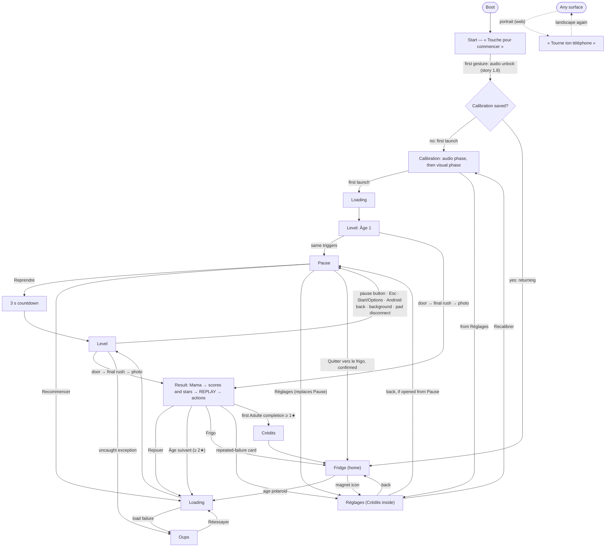

# EXPERIENCE.md — Papa Parade

This spine covers behaviour, flows and states. Visual identity is in [DESIGN.md](./DESIGN.md); tokens are referenced with `{…}` paths that resolve to its frontmatter.

- `[ASSUMPTION]` marks a facilitator decision. Geo delegated every open decision; all of them await his review.
- Constraints inherited from the sources cite their story or ARCH section and are not tagged.
- GDD and PRD content is inherited by reference, not restated.
- **Visual references**: four key-screen mockups in [`./mockups/`](./mockups/) are linked at the sections they illustrate. **The spines win on any conflict with a mockup.**

## Foundation

| Aspect | Commitment | Source |
|---|---|---|
| Platforms | Web first: mobile and desktop browsers, playtest by link. iOS and Android via Capacitor 8.5. Steam possibly later. | ARCH "Périmètre technique", story 8.1 |
| Orientation | Landscape only. Native builds lock it through Capacitor. On the web, portrait shows the "Tourne ton téléphone" overlay. | Story 1.4 |
| Input | Touch (primary), mouse, keyboard, gamepad (hot-plug). | Epic 1, story 1.16 |
| Engine / UI | Three.js r186 renders the world. The UI is a DOM/CSS overlay in vanilla TS; world-anchored UI uses `CSS2DRenderer`. No UI framework. | ARCH ADR-008 |
| Styling | kebab-case classes prefixed `pp-` (e.g. `pp-hud-gauge`). `src/client/ui/styles/tokens.css` mirrors the DESIGN.md frontmatter 1:1; `ui.css` holds the rules. | ARCH naming |
| Testability | Playwright can read every UI state through DOM classes or `window.__PP__`. | Story 2.4 |
| Feel data | Timing and juice values live in `content/feel.json`, multimodal mappings in `content/feedback.json`. This spine names behaviours; it gives numbers only where the decision log fixed them. | ARCH "Configuration", ADR-006 |
| Visual reference | DESIGN.md, plus 4 key-screen mockups: [`./mockups/key-hud-level.html`](./mockups/key-hud-level.html) (the HUD, world-anchored UI, auto-target and silence states), [`./mockups/key-fridge.html`](./mockups/key-fridge.html) (the Fridge: locked, drop-in and focus states), [`./mockups/key-result.html`](./mockups/key-result.html) (Result at ≥ 2★ with an unlock, and Mama woke at < 2★), [`./mockups/key-pause.html`](./mockups/key-pause.html) (Pause, armed quit, countdown). **Spine-only surfaces**, built from the spine tables alone: Start, Calibration, Loading, Réglages, Oups, "Tourne ton téléphone" (portrait), Crédits. The spines win on conflict. | Decision log [promote] |
| Stakes | Indie commercial (store release, E8), so the spine is written to production depth. `[ASSUMPTION]` | — |

## Information Architecture

The app flow sits on the locked `appFsm` (boot → calibration → menu → level → result, ARCH). Surfaces and routes are `[ASSUMPTION]` unless cited.

| Surface | Reached from | Purpose | Kind |
|---|---|---|---|
| Start | Boot | Title art over the dim nursery scene. It gets the first gesture (tap, click or key), which unlocks audio (stories 1.4, 1.8). | Screen |
| Calibration | Start (first launch), Réglages › Recalibrer | Measures the latency offset: an audio phase (8 beeps at 100 BPM), then a visual phase (8 flashes) (story 2.7). Runs on an `{colors.ink}` background. `[ASSUMPTION]` for the background | Screen |
| Loading | Fridge, Pause › Recommencer, Result, Oups | Preloads everything; nothing loads during play (ARCH "Gestion des assets", story 1.5). | Screen |
| Fridge | Returning launch, Result › Frigo, Pause › Quitter, Crédits | Home and age select: 5 captioned age polaroids, star magnets, locked slots. `[ASSUMPTION]` | Diegetic screen |
| Level | Loading | Play, with the HUD and world-anchored UI. | Play |
| Pause | Level | « Pause »: Reprendre · Recommencer · Réglages · Quitter vers le frigo. `[ASSUMPTION]` | Overlay (panel on scrim) |
| Result | End-of-level sequence | Frozen photo polaroid, Mama's reactions, 4 score rows, stars, highlight replay, then the actions (stories 1.21, 3.6–3.9, 3.11). `[ASSUMPTION]` for the composition | Diegetic screen |
| Réglages | Fridge magnet, Pause, repeated-failure card | Settings and Crédits (story 2.8). | Plain panel |
| Crédits | Réglages; plays automatically on the first Adulte completion with ≥ 1★ `[ASSUMPTION]` | Credits (content open upstream). | Plain panel |
| Oups | Load failure, uncaught exception | Light-tone error with "Réessayer" (story 1.5). | Plain panel |
| Portrait | Any surface (web) | Covers the game; the game stays paused (story 1.4). | Overlay |

Rules `[ASSUMPTION]`:

- First launch goes Start → Calibration → straight into Âge 1, with no menu ("immediate pick-up", NFR6). The player first reaches the Fridge from that level's Result.
- Nothing is deeper than 2 levels from the Fridge.
- Overlays never stack. Réglages opened from Pause replaces Pause and returns to it. Portrait and Oups replace whatever is showing.

**Result sequence** (follows the GDD macro loop) `[ASSUMPTION]`:

1. Photo polaroid.
2. Mama's reactions (mum-bubble).
3. Score rows and stars stamp in.
4. Highlight replay with the "REPLAY" banner (skippable).
5. The actions appear.

**Result actions by case** `[ASSUMPTION]` (illustrated in [`./mockups/key-result.html`](./mockups/key-result.html)):

| Case | Primary | Secondary | Tertiary | Header / extras |
|---|---|---|---|---|
| ≥ 2★, next age unlocked | "Âge suivant" | "Rejouer" | "Frigo" | « Nouvel âge débloqué ! » |
| < 2★ | "Rejouer" | "Âge suivant", visible but locked, with the hint « 2 étoiles pour débloquer » | "Frigo" | — |
| Adulte (last age) | "Frigo" (replaces "Âge suivant") | "Rejouer" | — | The first completion with ≥ 1★ plays the Crédits, then returns to the Fridge |
| Mama woke (any of the above) | per case | per case | per case | « Maman s'est réveillée ! » with its cue; the lost star is a dashed empty star with a « −1 » chip (story 3.2) |
| 3rd consecutive ≤ 1★ on the same level, outside Assistance | per case | per case | per case | Repeated-failure card (see State Patterns › Result) |

### HUD information hierarchy

The ranking follows the read-then-respond pillar and the HUD fade rule (see HUD & Diegetic UI).

| Rank | Elements | Where | Rule |
|---|---|---|---|
| 1 | verb-label, threat-icon, target-highlight, hold-ring, silence-bubble, glyph-chip | World-anchored, or at the screen edge | Always at full opacity; never hidden during active play |
| 2 | hud-gauge (max 3, in one horizontal pill: Bruit · Fatigue · Envie), hud-timer, sequence-bar | Top-left, top-centre | Fade to 70% opacity when idle `[ASSUMPTION]` |
| 3 | combo-badge, breath-ring, attention-meter | World-anchored over characters | Shown only when relevant `[ASSUMPTION]` |
| 4 | button-icon (pause) | Top-right | Always present during play (story 1.4) |
| — | Mama score | Never during play | Revealed only at the end; Papa's degrading look is the in-play hint `[ASSUMPTION]` |

## Voice and Tone

Microcopy rules `[ASSUMPTION]`:

- French, **tutoiement**, short.
- The Domestic register is warm and wry; the Epic register is trailer-parody caps.
- Verbs are imperative, one word where possible, uppercase and followed by " !" (with the French space).
- Failure is never named: no "échec", "perdu", "game over" or "mort" (NFR9).
- Never mock the baby or shame the parent. Mama is exasperated-loving, never cruel.
- No explanatory tutorial text anywhere in play (NFR6, story 6.9). Loading lines are flavour only, never instructions.
- Errors are light, never technical. Save failures are silent for the player.

### Canonical on-screen strings (French, verbatim)

Unless a source is cited, every string's wording is `[ASSUMPTION]`.

| String | Where | Source |
|---|---|---|
| "Touche pour commencer" | Start | Story 1.4 |
| « Le frigo » | Fridge: its Domestic name and small header | `[ASSUMPTION]` |
| « Tape en rythme avec les bips » | Calibration, audio phase | `[ASSUMPTION]` |
| « Tape à chaque flash » | Calibration, visual phase | `[ASSUMPTION]` |
| « Pas assez de taps, on recommence ? » | Calibration, phase re-proposed (fewer than 5 valid taps) | `[ASSUMPTION]` |
| « Pas de son ? Passe au visuel » | Calibration, audio phase | `[ASSUMPTION]` |
| « Calé ! » | Calibration complete | `[ASSUMPTION]` |
| « Préparation du biberon… », « On range les jouets… », « On cache les clés de voiture… » | Loading (they rotate) | `[ASSUMPTION]` |
| "Âge 1" | First level on first launch | `[ASSUMPTION]` |
| "Bébé à 4 pattes", "Petite enfance", "Enfance", "Adolescence", "Adulte" | Polaroid captions (age names) | GDD; captions `[ASSUMPTION]` |
| « Nouveau ! » | Fridge, on a newly unlocked polaroid | `[ASSUMPTION]` |
| "SOULÈVE !", "FERME !", "ÉCHANGE !" | verb-label examples (stored per threat in content JSON) | GDD, story 2.2 |
| "POSE-LE D'ABORD !" | verb-label when Firmness is impossible while carrying | Story 4.1 |
| « ESQUIVE ! » | Default dodge verb-label; a threat's content JSON may override it with a more specific verb | FR53; default `[ASSUMPTION]` |
| « PARADE PARFAITE » | epic-stamp on a perfect response | `[ASSUMPTION]` |
| « REPLAY » | epic-stamp banner during the highlight replay | ARCH P7, story 3.9 |
| "…" | silence-bubble | Story 1.20 |
| "Fatigue", "Bruit", "Envie" | hud-gauge names (Bruit in Sieste only) | `[ASSUMPTION]` |
| "Espace" | glyph-chip fallback when the key layout map is unavailable | `[ASSUMPTION]` |
| « Pause » | Pause panel title | `[ASSUMPTION]` |
| « Reprendre », « Recommencer », « Réglages », « Quitter vers le frigo » | Pause | `[ASSUMPTION]` |
| « Sûr ? Le niveau sera perdu. » | Armed label of "Quitter vers le frigo" | `[ASSUMPTION]` |
| « 3 » « 2 » « 1 » | Resume countdown | `[ASSUMPTION]` |
| « Manette débranchée. Rebranche-la pour reprendre. » | Pause panel after a gamepad-disconnect auto-pause | `[ASSUMPTION]` |
| « *Encore* l'étagère ?! » | mum-bubble example (Mama remembers past runs). Mama's lines are content-driven (`mama-lines.json`; the most specific line wins, story 3.8), so the mockup's use of this line is illustrative only | GDD |
| « Maman s'est réveillée ! » | Result header when Mama woke | `[ASSUMPTION]` |
| « Nouvel âge débloqué ! » | Result header when the next age unlocks | `[ASSUMPTION]` |
| « Rires » /40, « État du bébé » /30, « Sans soupir » /15, « Sans hurlement » /15 | score-row labels with their maxima (the rows add up to the score) | `[ASSUMPTION]` |
| « −1 » | Lost-star chip when Mama woke | `[ASSUMPTION]` |
| « Rejouer » | Result | Story 1.21 |
| « Âge suivant », « Frigo » | Result | `[ASSUMPTION]` |
| « 2 étoiles pour débloquer » | Hint under the locked "Âge suivant" | `[ASSUMPTION]` |
| « Envie de souffler ? Essaie le mode Assistance » | Repeated-failure card on Result | `[ASSUMPTION]` |
| « Copier le journal » → « Journal copié ! » | Result (playtest web builds only) | Stories 1.21, 3.3; confirmation `[ASSUMPTION]` |
| « Télécharger le journal » | The same button when the clipboard API fails | Story 3.3; fallback `[ASSUMPTION]` |
| « Difficulté » | Réglages | GDD, story 2.8 |
| « Assistance » + « Fenêtres plus larges, instinct activé » | Réglages, difficulty tier and its description | Tier name from the GDD; description `[ASSUMPTION]` |
| « Normal » + « Le jeu tel qu'il est pensé » | Réglages, difficulty tier and its description | Tier name from the GDD; description `[ASSUMPTION]` |
| « Papa expérimenté » + « Fenêtres serrées, aucune aide » | Réglages, difficulty tier and its description | Tier name from the GDD; description `[ASSUMPTION]` |
| « Appliqué à la prochaine partie » | Réglages, under Difficulté | Story 2.8 (applies to the next game); wording `[ASSUMPTION]` |
| « Musique », « Effets », « Voix », « Interface » | Réglages volumes (the four audio buses) | Buses from ARCH; labels `[ASSUMPTION]` |
| « Vibrations », « Réduire les animations », « Grands verbes » | Réglages | `[ASSUMPTION]` |
| « Recalibrer » | Réglages | Story 2.7 |
| « Crédits » | Réglages | `[ASSUMPTION]` |
| « Oups ! Quelque chose s'est renversé. » | Oups | "Oups" from story 1.5; sentence `[ASSUMPTION]` |
| « Réessayer » | Oups | Story 1.5 |
| « Tourne ton téléphone » | Portrait overlay (web) | ARCH deployment, story 1.4 |

Every DOM button also carries a French `aria-label` (see Accessibility Floor).

## Component Patterns

These are behavioural rules. The visual specs are in DESIGN.md › Components, under the same names.

| Component | Where | Behavioural rules |
|---|---|---|
| button-primary | Menus, panels | Shows the press on `pointerdown` (sticker press) and acts on `pointerup` inside the button; sliding out cancels. Enter, Space or A activates it when focused. At least 44×44pt (story 1.4). `[ASSUMPTION]` |
| button-secondary | Menus, panels | Same press and act rules as button-primary. "Quitter vers le frigo" is two-step: the first tap arms it (the label becomes « Sûr ? Le niveau sera perdu. »), a second tap within 3s confirms, and otherwise it reverts. A locked "Âge suivant" shows its hint and does nothing when pressed. `[ASSUMPTION]` |
| button-tertiary | Result "Frigo"; lowest-priority actions | Same press and act rules as button-primary, but with no lift to collapse. It never takes default focus when a primary action is present. `[ASSUMPTION]` |
| button-icon | HUD top-right (pause); Fridge top-right (magnet → Réglages); card close | Pause opens the Pause overlay at once, with no confirmation. The same overlay is reachable by Esc, gamepad Start/Options or Android back. At least 44×44pt. `[ASSUMPTION]` |
| hud-gauge | HUD top-left | At most 3 at once, side by side in one horizontal pill, ordered left to right Bruit · Fatigue · Envie; Bruit appears only in Sieste (hidden in Retour, story 3.10). Below 50% and idle it sits at 70% opacity; it goes to full opacity while changing or at ≥ 70%. At ≥ 70% the fill turns `{colors.gauge-warn}` and the icon chip pulses. Above 80%, noise fires a visual and a haptic cue (story 3.1). Each bar animates as a single `transform: scaleX` fill under a segment mask. `[ASSUMPTION]` for all thresholds except 80% |
| hud-timer | HUD top-centre | Counts down: Mama's sleep in Sieste (4 min), Mama's return in Retour (3 min) (GDD). One icon per variant. It switches to compact while a sequence-bar is shown and restores afterwards. `[ASSUMPTION]` for the icon and compact switch |
| sequence-bar | Directly under hud-timer | Slides in when a special sequence starts and out when it ends. Opponent "health" (diaper boss, story 5.7) drains in `{colors.gauge-warn}`. Player resources (calme, story 6.2; souffle) fill in `{colors.gauge-calm}`. `[ASSUMPTION]` |
| combo-badge | Above Papa | Hidden at x1; visible from x2 up to x8 (story 4.2). Cashing in the combo (baby put down safely) fires slow-mo plus an audio, visual and haptic cue (story 4.2). `[ASSUMPTION]` for the x2 threshold |
| breath-ring | Around Papa, stealth only | Fills while the breath is held (hold anywhere, E or RT), over the 6000ms breath gauge (story 4.9). Uses the hold-ring visual. `[ASSUMPTION]` |
| attention-meter | Above the toddler | 5 pips, visible throughout Petite enfance levels. Same fill and idle-opacity rules as hud-gauge. Shows the attention gauge (0–100, story 6.4). `[ASSUMPTION]` |
| verb-label | Above each telegraphed threat | Appears with the telegraph: one word, large. Dodge threats default to « ESQUIVE ! » unless their content overrides it `[ASSUMPTION]`. When verbs overlap they are offset, with the most urgent in front (story 2.2). Uses `{typography.verb-compact}` on compact surfaces; "Grands verbes" adds +25%. Never truncated. |
| threat-icon | On each threat | Parry is a `{colors.parry}` circle, dodge a `{colors.dodge}` triangle (story 2.2). The telegraph combines the icon, a soft pulsing `{colors.alert}` halo, a telegraph sound and a light vibration (stories 1.10, 2.4). The icon disappears when the threat resolves. |
| hold-ring | Around the pressed threat icon; on the baby for sniff | Starts filling on press over a threat and fills in 400ms (`holdMinMs`). Releasing before it closes gives Parade. If the ring closes, it is Fermeté: the ring pops solid `{colors.paper}` with a medium haptic (ADR-010). A 2px ink outer outline keeps it readable over light rooms. Sniff is a 1s hold on the baby. While Papa carries the baby, Firmness is impossible and the verb reads "POSE-LE D'ABORD !" (story 4.1). `[ASSUMPTION]` for the ring |
| glyph-chip | Beside the auto-targeted threat's verb | Keyboard and gamepad only, never on touch. Exactly one at a time; it follows the auto-target as it changes. The glyph swaps per device family (see Input Schemes). `[ASSUMPTION]` |
| target-highlight | On the targeted or pressed threat | On touch, the pressed threat is highlighted in the frame after `pointerdown`, within 50ms (story 1.10). On keyboard and gamepad, the auto-targeted threat stays highlighted while aiming (story 1.16). The highlight is a solid outline plus a bouncing chevron, so it reads differently from the halo by shape. `[ASSUMPTION]` for the form |
| silence-bubble | Screen edge, on the side of the silent zone | Appears on a suspicious silence, together with a music cut and a short vibration (story 1.20). Blinks at 3Hz or slower; under reduced motion it pulses at 1Hz or slower. Disappears on `SilenceEnded`, when the baby is found by tapping it. `[ASSUMPTION]` for the rates |
| tap-marker | Tapped floor point | Shown in the frame after `pointerdown` on the floor (story 1.6). Scales from 0.6 to 1.2 and fades over 300ms. `[ASSUMPTION]` for the animation |
| instinct-vignette | Screen edges | Shown during paternal instinct (≥ 3 threats and 2 misses in < 10s, at most once per 30s; GDD), with a heartbeat sound and a haptic twin (story 2.9). Never shown in the Papa expérimenté tier (GDD). |
| countdown | Centre, over the dimmed scene | A 3s real-time countdown after any resume (« 3 » « 2 » « 1 »): digits in `{typography.countdown}`, with a tick sound, a haptic and a pulse each second (ARCH "Boucle de jeu"). The AudioContext resumes at the end (story 1.8). `[ASSUMPTION]` for the per-second cues |
| epic-stamp | Over the scene | "PARADE PARFAITE" stamps on perfect responses for at most 900ms and never blocks input. The "REPLAY" banner stays for the whole highlight replay (story 3.9). `[ASSUMPTION]` for PARADE PARFAITE |
| polaroid | Fridge (ages), Result (end photo) | On the Fridge, tapping an unlocked polaroid (or focusing it and confirming) goes to Loading. A locked slot cannot be selected (story 6.9: only unlocked ages are playable). A new unlock drops its polaroid with a magnet "thunk" and a « Nouveau ! » label on its first appearance. Locked slots keep their age name visible in ink-soft. On Result, the polaroid holds the frozen photo (story 3.6). `[ASSUMPTION]` |
| star | Result, Fridge only; never in play | On Result, stars stamp in one by one, each with a sound and a light haptic, the last one heavy. On the Fridge, stars show as sticker magnets per age. A lost star (Mama woke) stamps last, as a dashed empty star with a « −1 » chip (story 3.2). `[ASSUMPTION]` for the stamping |
| mum-bubble | Result | Shows the most specific Mama line (story 3.8) for each reaction, in the order Laugh, Sigh, Scream (story 3.7). Mama's voice lines are always on screen in this bubble, which doubles as captions. `[ASSUMPTION]` for the bubble |
| score-row | Result | 4 rows, each showing points earned out of its maximum: « Rires » /40, « État du bébé » /30, « Sans soupir » /15, « Sans hurlement » /15 (story 1.21). Values count up, and the rows add up to the score. Rows appear after Mama's reactions and before the replay. `[ASSUMPTION]` for the labels and count-up |
| panel | Pause, Réglages, Oups, Crédits, repeated-failure card | Pops in with overshoot in 220ms or less; a plain fade under reduced motion. Esc, B or Android back closes it or goes back one level. Closing Pause this way equals "Reprendre", through the countdown. Default focus goes to the panel's first action, the first row in Réglages, and "Réessayer" on Oups. `[ASSUMPTION]` |
| settings-toggle | Réglages | Flips on tap or confirm and saves instantly; there is no Save button. "Vibrations" is hidden when `capabilities.haptics=false`. `[ASSUMPTION]` |
| settings-slider | Réglages volumes | One slider per bus (Musique, Effets, Voix, Interface). Drag it, or use left and right when it is focused; changes apply and save instantly. `[ASSUMPTION]` |
| settings-segmented | Réglages › Difficulté | Three segments: Assistance, Normal, Papa expérimenté. The selected tier's description shows below. Saves instantly and applies to the next game (story 2.8). `[ASSUMPTION]` for the control type |
| calibration-pulse | Calibration | Beats at 100 BPM: 8 beeps (with a ring pop each), then 8 flashes. Accepts tap, Espace or A. If there are fewer than 5 valid taps, the phase is re-proposed with « Pas assez de taps, on recommence ? ». Outliers beyond ±150ms are rejected (story 2.7). The audio phase offers « Pas de son ? Passe au visuel ». Ends on « Calé ! ». `[ASSUMPTION]` for the copy, the skip and the inputs |
| loading-indicator | Loading | The baby bottle fills until all level assets are ready (story 1.5); the fill is static under reduced motion. Flavour lines rotate. No progress percentage is shown. Load target: under 5s on 4G (NFR3). `[ASSUMPTION]` for the form |

## State Patterns

States are `[ASSUMPTION]` unless cited. "n/a" means the state cannot occur on that surface.

### Start

| State | Treatment |
|---|---|
| First run / cold | Title art over the dim nursery scene, with "Touche pour commencer". Accepts a tap, click or key (story 1.4). The first gesture unlocks audio (story 1.8). |
| Returning | Same screen; the gesture leads to the Fridge. |
| Muted (iOS silent switch, night play) | No difference: nothing on Start depends on sound. |
| Offline | n/a: static build, self-hosted fonts, no network calls (ARCH, NFR14). |
| Portrait (web) | The portrait overlay covers it. |

### Calibration

| State | Treatment |
|---|---|
| First run | Opens automatically after Start when no calibration is saved (ARCH P5). |
| From Réglages | "Recalibrer" opens it. It returns to Réglages and replaces the stored offset (story 2.7). |
| Too few valid taps | Phase re-proposed (fewer than 5 valid taps, story 2.7) with « Pas assez de taps, on recommence ? ». |
| Muted | « Pas de son ? Passe au visuel » skips the audio phase, keeping only the visual phase. |
| Haptics unsupported | No effect; calibration is audio and visual only. |
| Background | The current phase pauses and restarts from its beginning on return. |
| Keyboard / gamepad | Espace or A counts as a tap. |
| After a save failure | Calibration runs again, as on a first launch. |

### Loading

| State | Treatment |
|---|---|
| Cold load | The loading-indicator shows until all assets are ready. Nothing loads during play (story 1.5). |
| Error | A load failure opens Oups with "Réessayer" (story 1.5). |
| Offline (web) | A failed fetch takes the error path. Native builds bundle their assets. |
| Background | The load continues. The level waits for the foreground, then starts through the 3s countdown. |
| Reduced motion | The bottle shows a static fill. |

### Fridge

Illustrated in [`./mockups/key-fridge.html`](./mockups/key-fridge.html): state A is a new age unlocked, state B is keyboard/gamepad focus.

| State | Treatment |
|---|---|
| First run | Not shown before the first level; the player first reaches it from Result. |
| Locked age | Empty slot with a crayon "?"; the age name stays visible in ink-soft. Cannot be selected. |
| Unlocked age | Captioned polaroid with its star magnets; can be selected. Unlocking needs ≥ 2 stars on the previous age (GDD). |
| New unlock | The first time the Fridge shows the polaroid, it drops in with a magnet "thunk" and a « Nouveau ! » label in primary. |
| Focus (keyboard / gamepad) | Focus ring per DESIGN.md (`{spacing.focus-ring-width}` `{colors.primary}`). Stick, D-pad or arrows move between the polaroids and the magnet. |
| Gamepad disconnect | No pause is needed: touch and mouse still work, and focus is kept. |
| Offline / error | n/a: progress comes from the local save (ARCH "Persistance"). An invalid save silently falls back to defaults with a `warn` (ARCH). |

### Level

Illustrated in [`./mockups/key-hud-level.html`](./mockups/key-hud-level.html): state A is a touch parry in progress; state B is keyboard auto-target plus dodge, a reference composite showing two threats in one frame; state C is a suspicious silence.

| State | Treatment |
|---|---|
| First level (implicit tutorial) | One threat at a time, verb shown, no explanatory text (story 6.9, NFR6). |
| Active play | HUD in the story 1.4 zones; hierarchy as in Information Architecture. |
| Slow-mo (perfect, wave end) | The HUD stays. |
| End sequence (photo, Mama, replay) | The HUD hides entirely. |
| Muted | Every audio cue has a visual and a haptic twin (ADR-006, `mute.spec.ts`, story 2.4). A silence still shows the silence-bubble. |
| Haptics unsupported (Safari iOS web) | Haptics are a no-op (`capabilities.haptics=false`, story 1.8); visual and audio cues remain. |
| Background | Auto-pause, with the AudioContext suspended (stories 1.4, 1.8). |
| Gamepad disconnect | Auto-pause. The Pause panel shows « Manette débranchée. Rebranche-la pour reprendre. ». The pad reconnects by hot-plug without a reload (story 1.16). |
| Portrait (web) | Auto-pause behind the portrait overlay (story 1.4). |
| Error | An uncaught exception is logged, then Oups opens and the level restarts (story 1.5). |
| Instinct | instinct-vignette and heartbeat (story 2.9). |

### Pause

Illustrated in [`./mockups/key-pause.html`](./mockups/key-pause.html): state A is Pause, state B the armed quit, state C the 3, 2, 1 resume.

| State | Treatment |
|---|---|
| Entered | « Pause » panel on `{colors.scrim}`; the loop stops stepping (ARCH). The HUD stays visible under the scrim, dimmed and inert, through Pause and the countdown. Focus on "Reprendre". `[ASSUMPTION]` for the HUD treatment |
| Resume | "Reprendre", or back, starts the 3s countdown, then play resumes exactly where it stopped (FR14). Every resume goes through the countdown, including after background, disconnect or portrait. |
| Quit | The first tap arms "Quitter vers le frigo": its label becomes « Sûr ? Le niveau sera perdu. » on an `{colors.ink}` fill. A second tap within 3s confirms; otherwise the button reverts. No modal is stacked. |
| Réglages | Replaces Pause; back returns to Pause. |
| Background while paused | Stays paused. |
| Gamepad disconnect / reconnect | Stays paused and shows the disconnect line. Once reconnected, the pad navigates the panel. |

### Result

Illustrated in [`./mockups/key-result.html`](./mockups/key-result.html): state A is a 3-star result with an unlock; state B is Mama woke at under 2★.

| State | Treatment |
|---|---|
| Standard | Photo polaroid → mum-bubble per reaction (Laugh, Sigh, Scream) → 4 score-rows counting up and stars stamping in → REPLAY (story 3.9) → actions per the Result actions table in Information Architecture. |
| ≥ 2★ (next age unlocked) | Header « Nouvel âge débloqué ! » (story 3.11). Primary "Âge suivant", secondary "Rejouer", tertiary "Frigo". The new polaroid drops in on the next Fridge visit. |
| < 2★ | Primary "Rejouer". "Âge suivant" stays visible but locked, with « 2 étoiles pour débloquer ». |
| Adulte (last age) | "Frigo" replaces "Âge suivant" as primary. The first Adulte completion with ≥ 1★ plays the Crédits, then returns to the Fridge. |
| Mama woke (Sieste, noise at 100%) | Header « Maman s'est réveillée ! », with its cue (door-slam sound, visual, vibration). The lost star is a dashed ink-soft empty star with a « −1 » chip in mama-scream (story 3.2). Mama's line itself comes from content (`mama-lines.json`, story 3.8). |
| Repeated failure | After 3 consecutive results of ≤ 1★ on the same level, outside Assistance, one gentle card appears: « Envie de souffler ? Essaie le mode Assistance », with a button to Réglages. It can be dismissed and never shows in Assistance. |
| Replay skip | A tap skips the current moment; a second tap skips the whole replay (story 3.9). |
| Playtest build | « Copier le journal » appears only in playtest web builds, behind a build flag; store builds hide it (stories 1.21, 3.3). Success shows « Journal copié ! ». If the clipboard API fails, the button becomes « Télécharger le journal » and downloads a .json file. |
| Muted / haptics unsupported | Star stamps and Mama's cues keep their visual twins. |

### Réglages

| State | Treatment |
|---|---|
| Default | Difficulté (with tier descriptions), the four volumes, Vibrations, Réduire les animations, Grands verbes, Recalibrer, Crédits. Changes save instantly. Focus starts on the first row. |
| Haptics unsupported | The "Vibrations" row is hidden. |
| Opened from Pause | Replaces Pause. Difficulté shows « Appliqué à la prochaine partie ». |
| Opened from the repeated-failure card | Opens like the Fridge entry, with Difficulté as the first row. |
| Save failure | Silent for the player: defaults are restored with a `warn` (ARCH), and calibration re-runs as on a first launch. |

### Oups

| State | Treatment |
|---|---|
| Load failure | « Oups ! Quelque chose s'est renversé. » with "Réessayer", which goes back to Loading (story 1.5). Focus on "Réessayer". |
| Uncaught exception | Same panel; it offers a level restart (story 1.5). |
| Dev content error | Detailed error screen, in dev builds only (story 1.2). |

### Portrait (web only)

| State | Treatment |
|---|---|
| Rotate to portrait | "Tourne ton téléphone" covers the game, and any level in progress is paused (story 1.4). |
| Back to landscape | The overlay leaves. In a level, Pause shows, and resuming goes through the countdown. |
| Native | n/a: orientation is locked (story 8.1). |

## Interaction Primitives

- **Tap**: the main verb. One tap can mean several things; the hit-test priority is threat > object > floor, with a generous touch radius set in `feel.json` (ARCH "Chaîne d'entrées").
- **Hold**: decided at release or at 400ms (`holdMinMs`), with feedback through the hold-ring (ADR-010). Sniff is a 1s hold on the baby.
- **Swipe**: dodge on touch (story 5.1).
- **Hold anywhere**: holds the breath, in stealth only (story 4.9).
- **Press then act** `[ASSUMPTION]`: UI buttons show the press on `pointerdown` and act on `pointerup` inside the button. In play, judgement happens at press time (ARCH P3).
- **Pause (in play)** `[ASSUMPTION]`: the on-screen button, Esc, gamepad Start/Options, or Android back. B never pauses, because B + direction is dodge (story 5.1).
- **Back (in menus)** `[ASSUMPTION]`: B, Esc or Android back goes back one level.
- **Skip**: one tap skips a replay moment; a second tap skips the whole replay (story 3.9).
- **Focus** `[ASSUMPTION]`: every menu is fully navigable by keyboard and gamepad, with a visible focus ring. On desktop, mouse hover drives the same focus state.
- **Two-step destructive action** `[ASSUMPTION]`: arm on the first tap, confirm on the second within 3s. Never a stacked modal.
- **Banned**: text tutorial popups (NFR6); modals stacked on modals `[ASSUMPTION]`.

## HUD & Diegetic UI

- **Mockup**: [`./mockups/key-hud-level.html`](./mockups/key-hud-level.html) shows the HUD, the world-anchored UI, and the auto-target and silence states. Its state B is a reference composite.
- **Non-diegetic, screen-anchored**: hud-gauge, hud-timer, sequence-bar, button-icon (pause), countdown, silence-bubble. They sit in the locked zones (story 1.4), inside `{spacing.hud-inset}`.
- **World-anchored (CSS2D)**: verb-label, threat-icon, hold-ring, breath-ring, combo-badge, attention-meter, glyph-chip, target-highlight, tap-marker.
- **Diegetic only (3D world, no DOM)**: the baby's gaze lock, the `{colors.smell}` trail, drooping eyelids (microsleep), visual sound waves and bubbles, and Papa's degrading look, which is the only in-play hint of the Mama score (GDD; stories 1.7, 1.18, 3.7, 5.3).
- **Diegetic menus** `[ASSUMPTION]`: the Fridge and the Result polaroid.
- **Fade rule** `[ASSUMPTION]`: gauges under 50% idle at 70% opacity, and go to full opacity when changing or at ≥ 70%. The HUD hides during the photo, Mama's reactions and the replay. It stays during slow-mo, and stays visible but dimmed and inert under the scrim during Pause and the countdown.
- **Budget**: the whole HUD band stays within 12% of the room height (story 1.4), about 45px on a 375px-tall phone `[ASSUMPTION]`. This is why the gauges share one horizontal pill instead of stacking.

## Input Schemes

Bindings are inherited (GDD controls table, ARCH, stories 1.6, 1.16, 4.9, 5.1) unless tagged.

| Action | Touch | Keyboard | Gamepad |
|---|---|---|---|
| Move | Tap the floor | ZQSD / WASD (by physical position) or arrows | Left stick |
| Parry | Tap the threat | Space (tap) on the targeted threat | A |
| Firmness | Hold the threat ≥ 400ms | Space (hold) | A (hold) |
| Dodge | Swipe | Shift + direction | B + direction |
| Hold breath (stealth) | Hold anywhere | E (hold) | RT (hold) |
| Use object (coffee, phone) | Tap the object | Space near the object, with no threat active | A near the object |
| Pick up / find the baby | Tap the baby, outside a threat | Space near the baby | A near the baby |
| Sniff | Hold 1s on the baby | Space (hold) near the baby | A (hold) near the baby |
| Pause (in play) | button-icon or Android back `[ASSUMPTION]` | Esc `[ASSUMPTION]` | Start / Options `[ASSUMPTION]` |
| Menu confirm | Tap | Enter or Space `[ASSUMPTION]` | A `[ASSUMPTION]` |
| Menu back | Android back | Esc `[ASSUMPTION]` | B (menus only) `[ASSUMPTION]` |
| Calibration tap | Tap | Espace `[ASSUMPTION]` | A `[ASSUMPTION]` |

- **Keyboard layout** `[ASSUMPTION]`: keys are bound by `KeyboardEvent.code`, so ZQSD on AZERTY and WASD on QWERTY both work with no setting, and arrows always work. On-screen key glyphs use `navigator.keyboard.getLayoutMap()` when available, otherwise arrows and "Espace".
- **Gamepad glyphs** `[ASSUMPTION]`: they follow the detected pad family (PlayStation ✕ ○); Xbox-style A B is the default.
- **Prompts** `[ASSUMPTION]`: touch shows no prompts, because the world is the prompt. Keyboard and gamepad show one glyph-chip beside the auto-targeted threat's verb.
- **Targeting**: keyboard and gamepad auto-target the most urgent threat in the aimed direction (cone `autoTargetConeDeg`, 60° by default). With no direction, they target the most urgent threat overall (story 1.16).
- **Remapping** `[ASSUMPTION]`: out of v1 scope; revisit for Steam (see Open Items).
- **Debug**: F1 or a 3-finger tap, in dev or with `?debug=1` only; stripped from store builds (ARCH, story 1.23).

## Game Feel & Juice

World feel (hitstop 80ms, perfect slow-mo at ×0.3, shake, zoom, particles, adaptive music) is owned by `feel.json` and `content/feedback.json` (ARCH; stories 1.13, 2.4–2.6). The numbers there win. This section covers UI-level juice and the reduced-motion mapping.

| Moment | UI juice | Haptic |
|---|---|---|
| Button press | Sticker press on `pointerdown`, action on `pointerup` `[ASSUMPTION]` | — |
| Panel opens | Overshoot pop, 220ms or less `[ASSUMPTION]` | — |
| Perfect response | "PARADE PARFAITE" epic-stamp in `{typography.epic}`, at most 900ms `[ASSUMPTION]`; visual flash (story 2.4) | Heavy (story 2.4) |
| Telegraph | threat-icon with a pulsing `{colors.alert}` halo, plus the verb-label | Light (story 2.4) |
| Hold closes (Fermeté) | hold-ring pops solid `{colors.paper}` `[ASSUMPTION]` | Medium `[ASSUMPTION]` |
| Tap on the floor | tap-marker scales from 0.6 to 1.2 and fades over 300ms `[ASSUMPTION]` | — |
| Gauge warning | Icon chip pulses at ≥ 70% `[ASSUMPTION]` | Above 80% noise (story 3.1) |
| Stars | Stamp in one by one, each with a sound `[ASSUMPTION]` | Light each, heavy on the last `[ASSUMPTION]` |
| Score | score-rows count up `[ASSUMPTION]` | — |
| New unlock | The polaroid drops onto the Fridge with a magnet "thunk" and « Nouveau ! » `[ASSUMPTION]` | — |
| Resume | countdown digits pulse with a tick each second `[ASSUMPTION]` | On each tick `[ASSUMPTION]` |
| Final celebration | Opera choir, fireworks (story 7.4) | Visual and haptic twins (story 7.4) |

**Reduced motion** ("Réduire les animations") `[ASSUMPTION]`:

| Effect | Under reduced motion |
|---|---|
| Screen shake, perfect-camera rotation | Removed |
| Camera zoom | Capped at 50% |
| Particle counts | Cut by 60% |
| UI overshoot (panels) | Plain fade |
| Full-screen flash | Border glow |
| silence-bubble blink | Slow pulse, 1Hz or slower |
| Loading bottle | Static fill |
| Hitstop, slow-mo | Unchanged, because they are gameplay timing |
| Any flashing | Never faster than 3Hz, with or without the setting (calibration flashes run at 1.67Hz) |

## Responsive & Platform

| Surface | Definition | Differences |
|---|---|---|
| Compact `[ASSUMPTION]` | Landscape short side < 430px (phones) | Verbs at `{typography.verb-compact}`, 56px threat icons, touch first |
| Regular `[ASSUMPTION]` | Short side ≥ 430px (tablets, desktop) | Verbs at `{typography.verb}`, 64px threat icons |
| Desktop add-ons `[ASSUMPTION]` | A pointer with hover | Hover states and mouse focus |

- The HUD corners never move between surfaces. `[ASSUMPTION]`
- The iso camera keeps the whole room visible when the window resizes (story 1.4). DPR is capped at 2 and steps down 2 → 1.5 → 1 under load (ARCH).
- Safe-area insets use `viewport-fit=cover`, verified by a Playwright test in an iPhone 12 landscape viewport (story 1.4).
- Native builds (story 8.1): orientation locked; native haptics replace `navigator.vibrate`; auto-pause via `appStateChange`; saves via `@capacitor/preferences`.
- Web Safari on iOS: no haptics (`capabilities.haptics=false`), and the iOS silent switch mutes web audio. `[ASSUMPTION]` for the silent-switch note, which motivates the calibration skip.

## Inspiration & Anti-patterns

`[ASSUMPTION]`: the GDD's reference games are inherited, but the embrace/reject split is the facilitator's.

| Embrace | What we take |
|---|---|
| Overcooked | Warm, hand-made menus; chaos played as comedy |
| WarioWare | Giant one-word verbs |
| Peggle | Outsized celebration |
| Sekiro | Perfect-response audio (the baby's laugh) |
| Untitled Goose Game | Minimal HUD; the world comes first |

| Reject | Why |
|---|---|
| Text-tutorial popups | NFR6: the first level teaches by itself |
| Game-over or fail screens | NFR9: failure is a gag |
| HUD covering the room | Story 1.4: 12% at most, and a free bottom third |
| Mid-level ads | See Monetization Guard Rails |
| Tiny corner buttons | Buttons are at least 44×44pt (story 1.4) |
| Guilt-trip copy | Voice rule: never shame the parent. The repeated-failure card is an offer, never a verdict |

## Performance Budget (UI)

| Budget | Value | Source |
|---|---|---|
| Tap → visual feedback | 50ms or less: the highlight and the glide start in the frame after `pointerdown`, with no heavy work in handlers | NFR2, ARCH, story 1.10 |
| HUD DOM nodes | 40 or fewer | `[ASSUMPTION]` |
| Gauge animation | `transform: scaleX` only; no layout work | `[ASSUMPTION]` |
| CSS2D labels | Pooled; no per-frame allocation | `[ASSUMPTION]`; ARCH pooling rule |
| Filters | No blur filters and no `backdrop-filter` | `[ASSUMPTION]` |
| HUD updates | Batched once per frame | `[ASSUMPTION]` |
| Frame | 60 FPS on iPhone 12 and 2021 Android; p95 at 20ms or less in `perf.spec.ts` | NFR1, story 1.23 |
| Fonts | Self-hosted woff2, three families | `[ASSUMPTION]` |

## Localization

`[ASSUMPTION]` throughout.

- v1 ships in **French only** but is ready for i18n. All UI strings live in `content/strings.fr.json`; verbs and Mama lines already live in content JSON (story 2.2, ARCH P1). French `aria-label`s live in the same file.
- English is the first post-v1 locale. When it ships is still open (see Open Items).
- Layouts tolerate +30% string length and nothing truncates. That includes verbs: a long verb scales down, never ellipsizes.
- Key glyphs follow the physical layout through `getLayoutMap()` (see Input Schemes).

## Monetization Guard Rails

`[ASSUMPTION]` The business model is still open (GDD; to decide before E8). v1 reserves **no shop, ad or IAP surface**. Guard rails for later:

- Never interrupt a level.
- Never place anything between the photo and Mama's reaction.
- Any ad or unlock lives on the Fridge, between levels only.

## Accessibility Floor

| Area | Floor | Source |
|---|---|---|
| Targets | Every UI button is at least 44×44pt | Stories 1.4, 1.21 |
| Text | 16px or more everywhere, verbs 28px or more; "Grands verbes" adds +25% | Story 1.21; values `[ASSUMPTION]` |
| Colour | Colour is always doubled by shape (circle / triangle). Signal colours are reserved. Gauges meet 3:1 non-text contrast and also pulse when warning. Full contrast table in DESIGN.md › Colors | NFR8, story 2.2; gauges `[ASSUMPTION]` |
| Sound-off play | Every audio cue has a visual and a haptic twin, enforced by a test | NFR7, ADR-006, story 2.4 |
| Captions | Mama's voice lines always show on screen in the mum-bubble | `[ASSUMPTION]` |
| Haptics | "Vibrations" toggle, hidden where haptics are unsupported | Story 2.8; hiding `[ASSUMPTION]` |
| Motion | The "Réduire les animations" mapping; nothing flashes faster than 3Hz | `[ASSUMPTION]` |
| Timing | Latency calibration on first launch and from Réglages; hidden window tolerance; paternal instinct | GDD, story 2.7 |
| Difficulty | Assistance (+50% windows) / Normal / Papa expérimenté (−25%). After repeated struggle, a gentle card offers Assistance | GDD, story 2.8; card `[ASSUMPTION]` |
| Navigation | Menus are fully navigable by keyboard and gamepad, with a visible focus ring (`{spacing.focus-ring-width}` `{colors.primary}`) | `[ASSUMPTION]` |
| Screen readers | Every DOM button carries a French `aria-label`, and menus are screen-reader navigable. Gameplay is **not** screen-reader playable; this is a stated limit | `[ASSUMPTION]` |
| One hand | The touch scheme is single-finger, so the game is one-hand playable by design | `[ASSUMPTION]` |
| Volumes | Per-bus volumes (music, sfx, voice, ui) | Story 2.8 |
| Interruption | Pause at any time with an exact resume. Auto-pause on background, pad disconnect and portrait | FR14; triggers `[ASSUMPTION]` |
| Content | All ages; no injury shown; no game over | NFR9 |
| Remapping | Not in v1 (open for Steam) | `[ASSUMPTION]` |

## Key Flows

### Flow 1: Julien, from first launch to his first perfect parry

Julien, 33, is a first-time dad. It is 22:40; he is on the couch with an iPhone 12, sound off because the baby just fell asleep. `[ASSUMPTION]`

1. He opens the game in landscape. Start is mostly the dim nursery scene with "Touche pour commencer"; nothing bright lights up the room.
2. He taps. The gesture unlocks audio, which the silent switch keeps muted. No calibration is saved, so Calibration opens on its `{colors.ink}` background.
3. The audio phase shows « Tape en rythme avec les bips », and he hears nothing. He taps « Pas de son ? Passe au visuel ».
4. « Tape à chaque flash ». He taps along with 8 `{colors.paper}` disc flashes. The screen shows « Calé ! » and saves the offset.
5. The bottle fills (« Préparation du biberon… »), then he lands straight in Âge 1, with no menu. The HUD shows this level's gauges top-left, the timer pill and the pause button.
6. The first threat telegraphs: a `{colors.parry}` circle threat-icon with a pulsing `{colors.alert}` halo, and its verb-label above in `{typography.verb-compact}`. No text explains anything.
7. He taps the threat. The target-highlight shows in the next frame, and Papa glides over.
8. **Climax:** his tap lands in the perfect window. Hitstop, ×0.3 slow-mo, and a visual flash standing in for the sound he cannot hear. "PARADE PARFAITE" stamps in `{typography.epic}` for under a second. He grins without waking anyone.

Branches:

- **Too early or too late**: a cartoon gag plays (the lamp goes off, Papa's hair stands up; story 1.10). No failure text; the next threat comes.
- **Fewer than 5 valid flash taps**: « Pas assez de taps, on recommence ? » and the phase restarts (story 2.7).
- **Web or native**: on the web build, haptics are a no-op in Safari iOS and "Vibrations" is hidden. On the native build, the heavy haptic fires on the perfect.
- **Phone rotated to portrait mid-level (web)**: "Tourne ton téléphone" shows and the game pauses. Back in landscape, he goes through Pause and the countdown.

### Flow 2: Priya, on the playtest link, wakes Mama

Priya is an external playtester on a QWERTY laptop, using the keyboard, from the playtest link. `[ASSUMPTION]`

1. She opens the link in a desktop browser and presses a key on Start; audio unlocks.
2. Calibration runs both phases with sound. She taps Espace in rhythm, and « Calé ! » confirms.
3. Âge 1 loads (here a Sieste variant; which variant each age uses is set in content). She moves with WASD, bound by physical key. The glyph-chip beside the targeted verb shows her real key name, read from the layout map.
4. Aiming with the movement keys re-targets. The `{colors.alert}` target-highlight outline and its chevron follow the most urgent threat in her direction.
5. Her noisy responses fill the Bruit gauge. At 70% it turns `{colors.gauge-warn}`, its icon chip starts pulsing, and it goes to full opacity. Above 80%, a visual and haptic cue warns her (story 3.1).
6. Bruit reaches 100%. Mama wakes, and the level ends early with the door-slam cue (story 3.2).
7. Result shows the photo polaroid under the header « Maman s'est réveillée ! ». The mum-bubble plays Mama's reactions, and the score-rows count up (« Rires » /40, « État du bébé » /30, « Sans soupir » /15, « Sans hurlement » /15). The lost star stamps as a dashed empty star with a « −1 » chip.
8. **Climax:** Mama's line (content-driven; « *Encore* l'étagère ?! » would come on a later run) makes her laugh out loud. The lost star reads as a gag, not a failure.
9. The REPLAY plays; she taps twice to skip it. With fewer than 2★, "Rejouer" is the primary action and "Âge suivant" shows « 2 étoiles pour débloquer ».
10. She presses « Copier le journal » (one gesture, story 3.3); the button confirms « Journal copié ! ». She sends the log to the team.

Branches:

- **Clipboard API fails**: the button becomes « Télécharger le journal » and downloads a .json file.
- **No `getLayoutMap()` in her browser**: the glyph-chip falls back to arrows and "Espace".
- **Third result in a row at 1★ or less on this level, outside Assistance**: the card « Envie de souffler ? Essaie le mode Assistance » appears. She can dismiss it or open Réglages.

### Flow 3: Karim, interrupted by real life, unlocks the next age

Karim, 41, is a returning player using a gamepad on desktop. `[ASSUMPTION]`

1. He launches and presses a button on Start. Calibration is already saved, so he lands on the Fridge (the `{colors.fridge}` door).
2. With the stick he moves the `{colors.primary}` focus ring across the captioned polaroids; locked ages show a crayon "?". He confirms the current age with A.
3. The level loads. The glyph-chip shows Xbox-style glyphs (✕ ○ on a PlayStation pad).
4. Mid-level, his real baby cries. He presses Start/Options: the « Pause » panel opens on `{colors.scrim}`, the HUD dims and goes inert behind it, and "Reprendre" is focused.
5. Ten minutes later he comes back and picks "Reprendre". The countdown shows « 3 » « 2 » « 1 » in `{typography.countdown}` with a tick and a pulse each second, and play resumes at the exact instant he left.
6. The door opens with its key sound (story 3.5) and the final rush starts. He tidies objects with contextual A in the last 10s.
7. Photo, Mama's reactions, score-rows. Two `{colors.star}` stars stamp in, the last with a heavy haptic. Result shows « Nouvel âge débloqué ! » (story 3.11), with "Âge suivant" as the primary action.
8. He picks the tertiary "Frigo" button instead.
9. **Climax:** the new age's polaroid drops onto the Fridge with a magnet "thunk" and a « Nouveau ! » label, where the "?" used to be.

Branches:

- **He walks away without pausing and the pad powers off**: the disconnect auto-pauses the game, and the Pause panel shows « Manette débranchée. Rebranche-la pour reprendre. ». The pad hot-plugs back without a reload (story 1.16).
- **The browser tab goes to the background**: auto-pause, with the AudioContext suspended, then resumed after the countdown (story 1.8).
- **Only 1 star**: no unlock, and the slot keeps its "?". "Rejouer" is primary and restarts with a new seed (story 1.21).
- **He wants to quit**: the first press arms "Quitter vers le frigo" (« Sûr ? Le niveau sera perdu. »), and a second press within 3s confirms. B on the panel goes back, which resumes through the countdown. B never pauses in play.
- **It is the Adulte level**: "Frigo" is the primary action. The first completion with ≥ 1★ plays the Crédits, then returns to the Fridge.

## Open Items

Still genuinely open upstream:

- **Business model**: paid, free with ads, or demo + full. To decide before E8 (GDD, ARCH, IRR). The Monetization Guard Rails apply in the meantime.
- **Adult-level tone**: does it stay funny or turn emotional? (GDD, IRR)
- **Firmness in E1** (IRR M7; story 1.22 is optional). This decides when the hold-ring ships.
- **"Glide too fast" in disarm** (IRR G6/M10): the player has no controlled slow approach. To settle before story 6.2.
- **Response variants** such as an outlet cover or a toy distraction (IRR G5).
- **Remapping for Steam**: out of v1; the bindings screen will be specified with the Steam port.
- **Crédits content**: the surface exists (in Réglages, and automatic after the first Adulte completion); its contents do not.
- **English locale timing**: English is the first post-v1 locale; when it ships is not set.

**Review:** every `[ASSUMPTION]` item in both spines was made by the facilitator under Geo's delegation and awaits his review in an Update pass.
